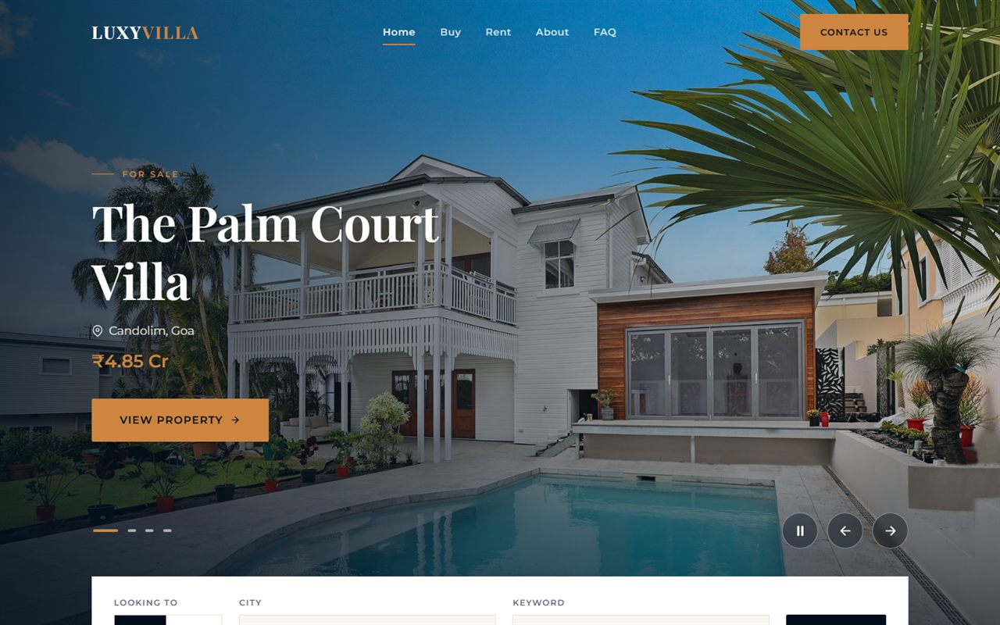
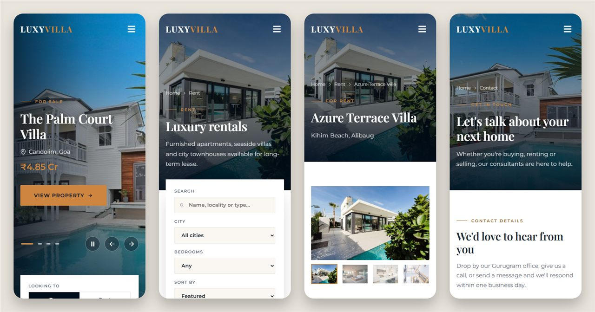
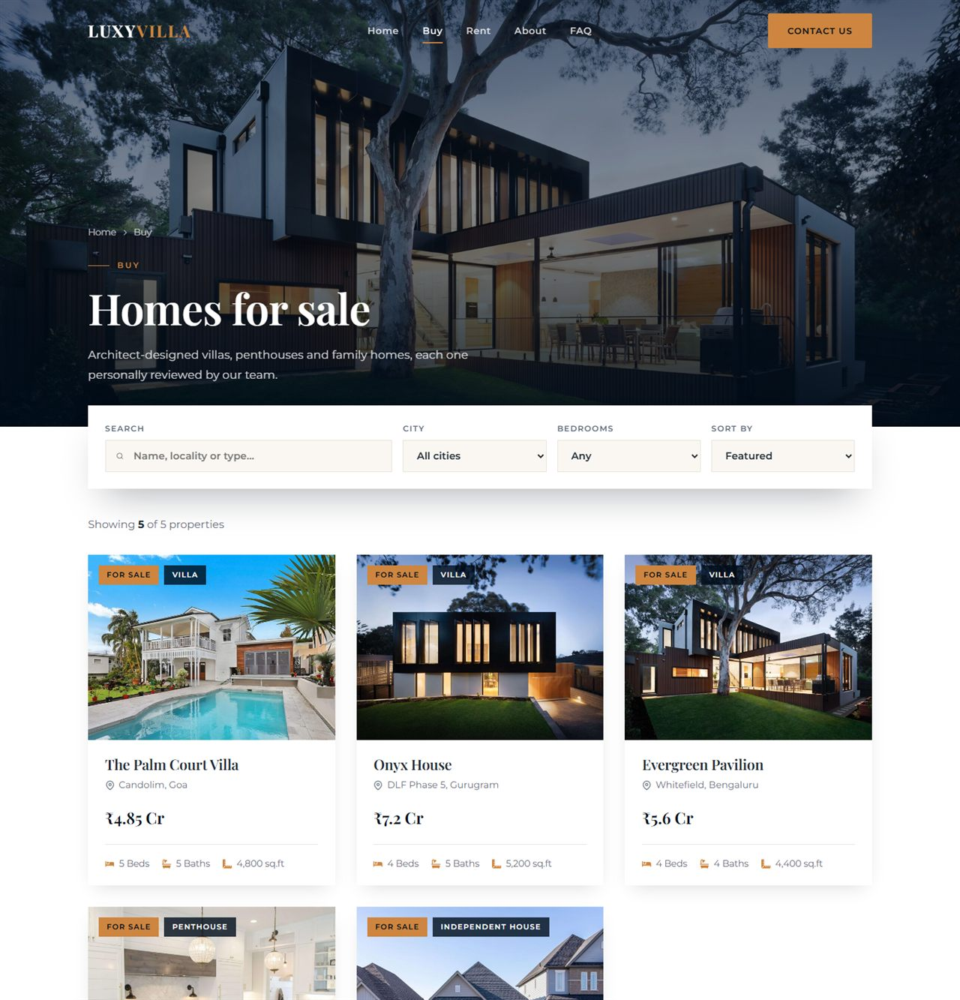
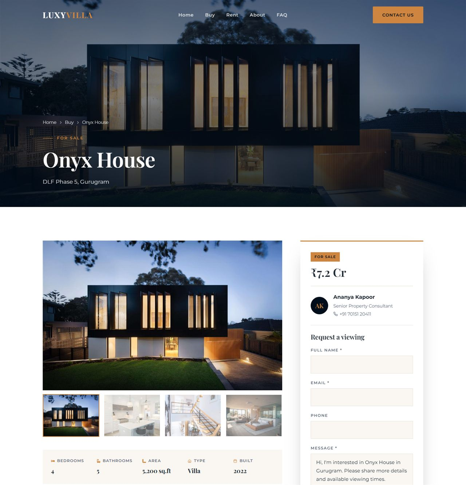
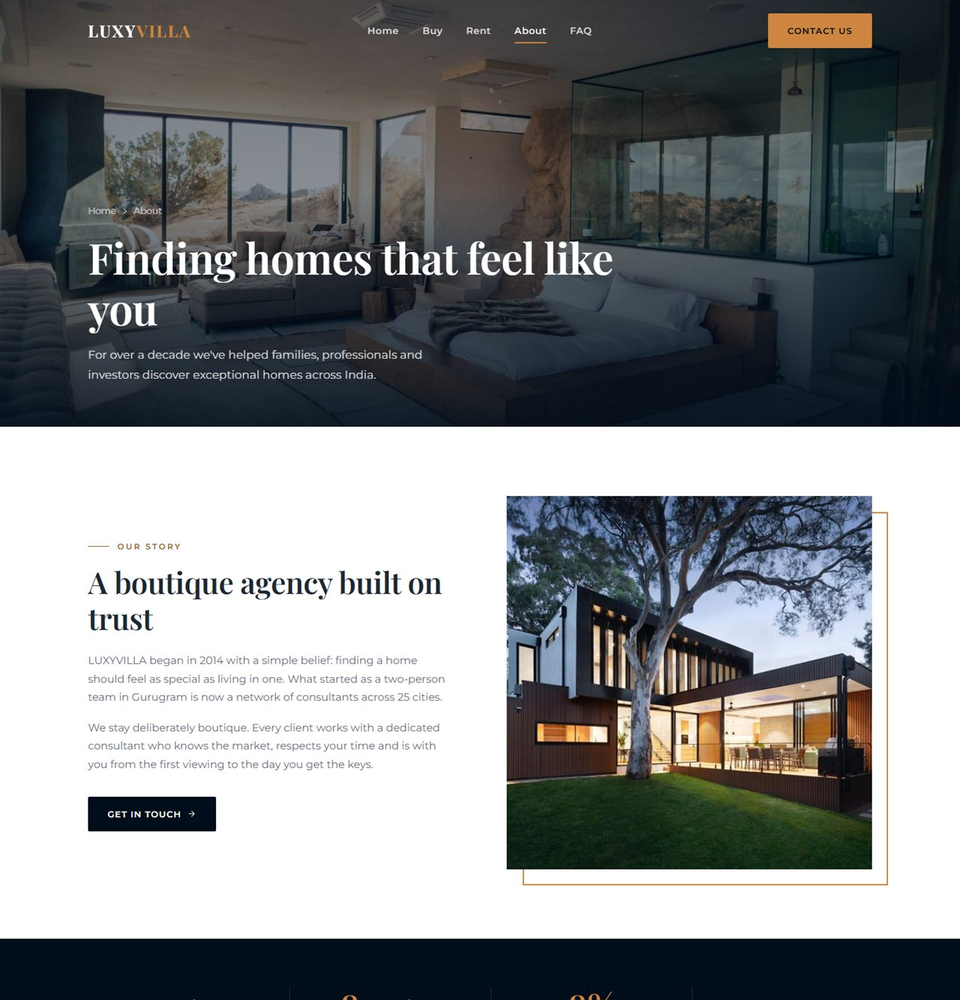
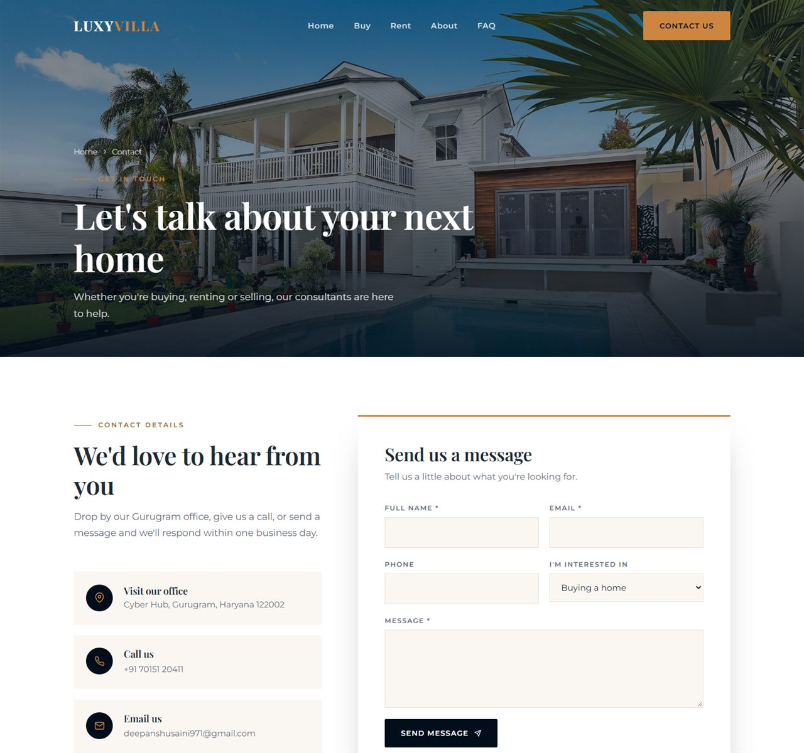

# LUXYVILLA: Luxury Homes & Rentals

A fast, accessible, fully responsive real estate website built with **React**, **React Router** and **styled-components**. Visitors can browse luxury homes to buy or rent, filter and sort listings, explore detailed property pages and send enquiries, on any device from a 320px phone to a widescreen desktop.



---

## Table of contents

- [Screenshots](#screenshots)
- [Features](#features)
- [Tech stack](#tech-stack)
- [Getting started](#getting-started)
- [Available scripts](#available-scripts)
- [Project structure](#project-structure)
- [Pages & routes](#pages--routes)
- [Customising content](#customising-content)
- [Responsive design](#responsive-design)
- [Accessibility](#accessibility)
- [Performance](#performance)
- [Security](#security)
- [Testing](#testing)
- [Deployment](#deployment)
- [Browser support](#browser-support)
- [Roadmap](#roadmap)
- [Author](#author)

---

## Screenshots

### Mobile



### Buy: searchable listings



### Property details



<details>
<summary><strong>More screenshots (About, Contact)</strong></summary>

### About



### Contact



</details>

---

## Features

**Browsing**
- Home page hero slider with autoplay, pause/play, previous/next and slide dots
- Quick search (Buy / Rent, city, keyword) that opens the matching listings
- **Buy** and **Rent** pages with keyword search, city and bedroom filters, and sorting by price or size
- Filters can be pre-set from the URL, e.g. `/buy?city=Goa&q=villa`
- Clear empty state with a one-click "Clear filters"

**Property pages**
- Photo gallery with thumbnails
- Key facts (beds, baths, area, type, year built), description, amenities and location
- Enquiry form that stays in view while scrolling (desktop) with a pre-filled message
- "Similar properties" suggestions
- Friendly "Property not found" page for removed listings

**Company & support**
- About page with story, stats, values and a four-step process
- Contact page with office details, a validated form and an embedded map
- FAQ with an accordion, plus Terms of Service and Privacy Policy pages
- Custom 404 page

**Quality**
- Mobile menu with focus trap, Esc to close and scroll lock
- Per-page browser titles, scroll-to-top and focus management on navigation
- Old `/homes` and `/rentals` links redirect to `/buy` and `/rent` (filters kept)

---

## Tech stack

| Area | Technology |
| --- | --- |
| UI | React 17 |
| Routing | React Router 5 |
| Styling | styled-components 5 (theme tokens in `src/theme.js`) |
| Icons | react-icons |
| Fonts | Playfair Display & Montserrat (Google Fonts) |
| Tooling | Create React App 5 (webpack 5, Babel, ESLint) |
| Testing | Jest + React Testing Library |

---

## Getting started

**Prerequisites:** Node.js 16 or newer (tested on Node 23) and Yarn 1.x.

```bash
# 1. Clone
git clone https://github.com/thedeepanshu/responsive-react-website.git
cd responsive-react-website

# 2. Install dependencies
yarn install

# 3. Start the dev server at http://localhost:3000
yarn start
```

> **Tip:** if the dev server ever shows a stale or odd compile error after a dependency change, stop it, delete `node_modules/.cache`, and run `yarn start` again.

---

## Available scripts

| Command | What it does |
| --- | --- |
| `yarn start` | Runs the app in development mode with hot reload |
| `yarn test` | Runs the test suite in watch mode (`CI=true yarn test` runs it once) |
| `yarn build` | Creates an optimised production build in `build/` |

---

## Project structure

```
responsive-react-website/
├── docs/screenshots/      README images
├── public/
│   ├── _headers           Security & caching headers (Netlify / Cloudflare Pages)
│   ├── _redirects         SPA routing rule (Netlify / Cloudflare Pages)
│   ├── favicon.svg, favicon.ico, logo192.png, logo512.png
│   ├── index.html         HTML shell, meta tags, fonts
│   └── manifest.json      PWA metadata
├── src/
│   ├── components/        Reusable UI: Navbar, Dropdown (mobile menu), Hero, HeroSearch,
│   │                      PageHero, Listings, PropertyCard, EnquiryForm, Accordion,
│   │                      Testimonials, Stats, CtaBanner, Footer, SkipLink, ...
│   ├── pages/             Route components: Home, Buy, Rent, PropertyDetail, About,
│   │                      Contact, Faq, LegalPage, NotFound
│   ├── data/              All site content: properties, images, slider, testimonials,
│   │                      FAQ, legal text, menu, footer, contact details
│   ├── hooks/             useDocumentTitle
│   ├── images/            Photos (full size) and images/thumbs (800px versions)
│   ├── utils/format.js    Price (₹ Cr / L / per month) and area formatting
│   ├── theme.js           Colours, fonts, breakpoints, shadows, animations
│   ├── globalstyles.js    Base styles, focus styles, reduced-motion rules
│   └── App.js             Layout, routes and code splitting
├── .env                   Build settings (no inline runtime script, no image inlining)
├── .env.production        Disables source maps in production
└── vercel.json            SPA routing + security headers for Vercel
```

---

## Pages & routes

| Route | Page |
| --- | --- |
| `/` | Home |
| `/buy` | Homes for sale (supports `?city=` and `?q=`) |
| `/rent` | Homes for rent (supports `?city=` and `?q=`) |
| `/property/:id` | Property details, e.g. `/property/onyx-house` |
| `/about` | About us |
| `/contact` | Contact details, form and map |
| `/faq` | Frequently asked questions |
| `/terms`, `/privacy` | Legal pages |
| anything else | 404 page |

---

## Customising content

All content lives in `src/data/`, so most changes don't touch any component code.

| To change... | Edit |
| --- | --- |
| Properties (add, remove, edit) | `src/data/PropertyData.js` |
| Photos used across the site | `src/data/images.js` |
| Home page slider | `src/data/SliderData.js` (list of property ids) |
| Phone, email, address, hours, social links | `src/data/SiteData.js` |
| Navigation links | `src/data/MenuData.js` |
| Footer links | `src/data/FooterData.js` |
| Testimonials | `src/data/TestimonialData.js` |
| FAQ / Terms / Privacy | `src/data/FaqData.js`, `src/data/LegalData.js` |
| Colours & fonts | `src/theme.js` |

**Adding a property:** add an object to the `properties` array in `PropertyData.js` with a unique `id`, `status: "sale"` or `"rent"`, price, details and images. It appears automatically in the listings, filters, search and its own `/property/<id>` page.

**Adding a photo:** put the full-size image (max ~1920px wide) in `src/images/`, create an 800px-wide copy in `src/images/thumbs/`, and register both in `src/data/images.js`.

---

## Responsive design

- Mobile-first layouts built with CSS Grid and Flexbox, with breakpoints at **480px, 768px, 900px and 1024px** (`src/theme.js`)
- Fluid typography using `clamp()`, so headings scale smoothly between phone and desktop
- Navigation collapses into a full-screen menu below 900px
- Filters, forms, galleries and the footer re-flow into one or two columns on small screens
- Tested at 320px, 390px, 768px, 1024px and 1440px widths

---

## Accessibility

Built to follow **WCAG 2.1 AA** guidelines:

- **Keyboard:** "Skip to content" link, visible focus styles, a focus trap in the mobile menu (Esc closes and focus returns to the menu button), and fully keyboard-operable slider, gallery, accordion and filters
- **Screen readers:** semantic landmarks (`header`, `nav`, `main`, `footer`), breadcrumbs, labelled controls, `aria-expanded` / `aria-pressed` / `aria-current` states, live announcements for search results and form status, and focus moved to the new page on navigation
- **Forms:** every field has a label, required fields are marked, errors are linked to their fields, and focus jumps to the first error
- **Motion:** the hero slider has a play/pause button that always reflects its real state. Using the arrows, dots or slide link stops autoplay (Play resumes it), and it doesn't autoplay when the system asks for reduced motion. All animations respect `prefers-reduced-motion`
- **Contrast:** body and label colours were checked against WCAG AA (4.5:1); small gold text on light backgrounds uses a darker gold (`#9a5f24`, about 5.2:1)
- **Touch:** controls have tap targets of at least 44px

---

## Performance

- **Code splitting:** only the home page ships in the main bundle (~89 kB gzipped). Every other page is loaded on demand with `React.lazy`.
- **Responsive images:** every photo has an 800px version, and `srcSet` + `sizes` let phones download the small file instead of the full-size one.
- **Lazy loading:** below-the-fold images use `loading="lazy"` and `decoding="async"`. Hero slides only download when they're about to be shown, and the first hero image is loaded with high priority.
- **Optimised assets:** the original photos (~18 MB) were resized and recompressed to ~2.7 MB, plus small thumbnails. No images are inlined into the JavaScript.
- **Fonts:** Google Fonts are preconnected and use `font-display: swap`.
- **Caching:** hashed `/static/*` files are served with a one-year immutable cache (see `public/_headers` / `vercel.json`).

---

## Security

- **Strict Content-Security-Policy:** scripts only from the site itself (no inline scripts; `INLINE_RUNTIME_CHUNK=false`), with fonts, styles and the map frame limited to Google's domains
- **Security headers:** HSTS, `X-Content-Type-Options: nosniff`, `X-Frame-Options: DENY` / `frame-ancestors 'none'` (clickjacking protection), `Referrer-Policy`, `Permissions-Policy` and `Cross-Origin-Opener-Policy`
- **No source maps in production** (`.env.production`)
- **Safe rendering:** React escapes all content; no `dangerouslySetInnerHTML` is used
- **Forms:** input is validated, trimmed and length-limited
- **External links** use `rel="noopener noreferrer"`, and the Google Maps embed is sandboxed

> Headers are applied by your hosting platform. `public/_headers` covers Netlify and Cloudflare Pages, and `vercel.json` covers Vercel. On other hosts, configure the same headers on the server.

---

## Testing

```bash
CI=true yarn test --watchAll=false
```

The test suite (`src/App.test.js`) covers:

- Home page rendering and the Buy / Rent navigation labels
- Listing filters and URL query parameters
- Redirects from the old `/rentals` URL
- Property details and the "not found" state
- The 404 page
- Contact form validation, including focus on the first error
- Hero slider autoplay, play/pause and manual navigation (`src/components/Hero.test.js`)

---

## Deployment

`yarn build` produces a static site in `build/` that can be hosted anywhere.

| Host | Setup |
| --- | --- |
| **Netlify** | Build command `yarn build`, publish directory `build`. `_headers` and `_redirects` are picked up automatically. |
| **Vercel** | Import the repo. `vercel.json` adds SPA routing and the security headers. |
| **Cloudflare Pages** | Build command `yarn build`, output directory `build`. Uses `_headers` and `_redirects`. |
| **Other hosts** | Serve `index.html` for every route (SPA fallback) and add the headers from `public/_headers`. |

> Without the SPA fallback, deep links such as `/property/onyx-house` return 404 on refresh.

---

## Browser support

Latest versions of Chrome, Edge, Firefox and Safari (desktop and mobile), plus browsers with more than 0.2% usage (see `browserslist` in `package.json`).

---

## Roadmap

- [ ] Connect the enquiry and contact forms to a backend or form service (e.g. Formspree, EmailJS). They currently validate and show a success message but don't send anything yet.
- [ ] Load properties from a CMS or API instead of `PropertyData.js`
- [ ] Save favourite properties
- [ ] Map view of listings
- [ ] Add a license file

---

## Notes

- Property listings, testimonials and agent names are **sample content** for demonstration.

---

## Author

[@thedeepanshu](https://github.com/thedeepanshu)

If you find this project useful, consider giving it a ⭐ on GitHub.
